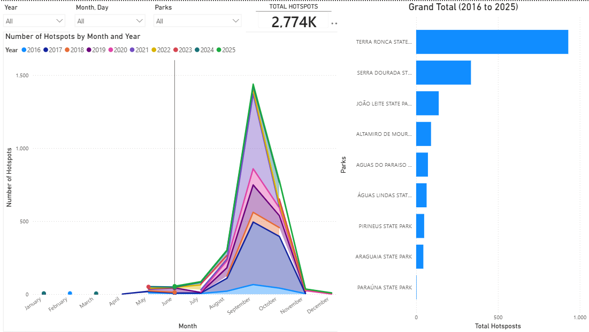
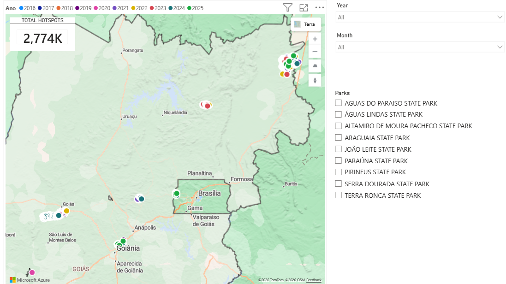
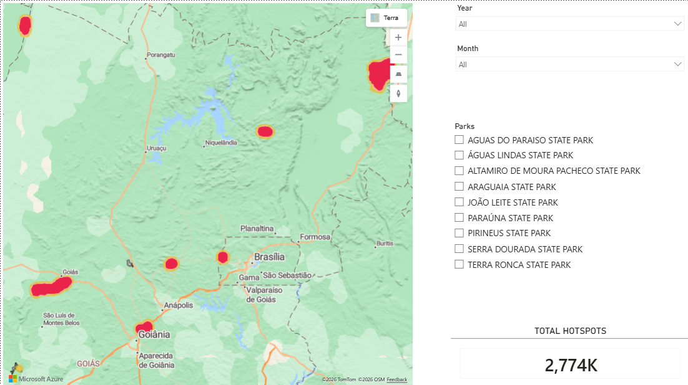

# Does a 3-Year Fire Rule Hold in the Cerrado? Heat-Hotspot Recurrence in Goiás State Parks, Brazil

Power BI, QGIS, Excel and Python analysis of 2,771 satellite heat hotspots recorded in 9 Goiás state parks between 2016 and 2025. The Goiás Military Fire Department (CBMGO) needed to answer an operational question: **after a fire, does Cerrado vegetation take about three years to recover enough fuel to burn again?** If so, recently burned areas could be left out of inspection rounds for three years. This project tests that assumption with ten years of satellite data, shows that the protection after a fire lasts about one year, not three, and proposes a safer way to prioritize prevention.

**[View the interactive Power BI dashboard](https://app.powerbi.com/view?r=eyJrIjoiNWRkNDQwN2QtOGRjOS00NjMwLTkzNTctMTBkMDZmZjY2YzhlIiwidCI6Ijk1NDYxM2ZhLWUzN2UtNDZkNi04NGYxLTJmYjNmMzY3MjExMyJ9)**

## Sample Delimitation

Of the 12 State Parks in Goiás, **9 recorded at least one heat hotspot** between 2016 and 2025 and form the sample:

- Águas do Paraíso State Park
- Águas Lindas State Park
- Altamiro de Moura Pacheco State Park
- Araguaia State Park
- João Leite State Park
- Paraúna State Park
- Pirineus State Park
- Serra Dourada State Park
- Terra Ronca State Park

Recurrence (the same location burning again) was observed in 8 of them. Paraúna recorded a single hotspot.

> **Methodological note:** The *Mata Atlântica*, *Serra de Caldas Novas* and *Serra de Jaraguá* state parks were excluded because no heat hotspot fell within their boundaries in the period, after the state-wide dataset was filtered by park limits. Satellite detection has known limits: small or short fires, or fires under cloud cover, may be missed. A park with no hotspot may therefore still have had undetected fires.

## Key Findings

- **The 3-year rule does not hold: fire protects an area for about one year, not three.** Burning in one year halves the odds of burning again the next year (odds ratio 0.54; p < 0.001). By the second year, the annual chance of a new fire has already doubled, from 6.4% to 12.7%, and it stays at that level in years 3 and 4 (13.4% and 16.2%).
- **More than 1 in 5 burned areas burns again within 3 years.** Kaplan-Meier survival analysis shows that 12.5% of burned areas burned again within 2 years and 22.7% within 3 years (95% CI: 19.6–25.8%). A 3-year skip would leave exactly these areas off the inspection list.
- **The most common interval was 2 years, consistent with the jump in risk in the second year.** Among the 499 recurrences, 2-year intervals were the most frequent (26.1%), followed closely by 4 and 3 years (23.0% and 22.4%).
- **Three years is a typical gap, not a safe minimum.** The median interval between fires at the same location is 2.98 years, statistically no different from 3 (Wilcoxon, p = 0.26), and the mean is 3.05 years. The average is close to the assumption, but the risk returns long before it: what matters for inspections is when protection ends, not the average gap.
- **Why protection ends so early: grasses are the leading explanation.** Cerrado studies report that the native grass layer recovers 70–80% of its biomass one year after fire and about 100% after two years, and invasive African grasses add even more fuel. This matches the jump in risk in the second year. This explanation comes from the literature and was not tested with project data.
- **Where and when fire happens is predictable.**
  - **Two parks:** Terra Ronca and Serra Dourada hold 71.3% of all hotspots.
  - **Three months:** 90.8% of hotspots fall between August and October, and September was the peak month in 7 of 10 years.
  - **Dry spells:** months with more days without rain have far more hotspots (Spearman ρ = 0.83 across monthly averages).
  - **Clusters:** fire is spatially clustered (Moran's I = 0.33; p = 0.001).
  - **Speed varies by park:** areas in Araguaia burn again faster (median 2.1 years) than in Serra Dourada (4.0 years).
- **Recommendation:** do not adopt the 3-year skip. Keep recently burned areas on the inspection list from the second year on, prioritize park sectors by hotspot history, season and drought, and back-test the ranking after each fire season.

## Project Overview

This project, originally a capstone (TCC) at CBMGO, was restructured with a problem-solving method called **DEASA**, taught by mentor Ale Saito (EdukaNegócios). **DEASA is a Portuguese acronym**, which is why the letters do not match the English step names (for example, E = *Estruturar* = Structure, and S = *Soluções* = Solutions):

| Letter | Portuguese | English | What happens in this step |
| --- | --- | --- | --- |
| **D** | Definir | Define | Frame the problem with the ACERT checklist (explained below) |
| **E** | Estruturar | Structure | Break it down into a hypothesis tree with necessary conditions, plus a MECE root-cause tree |
| **A** | Analisar | Analyze | Process the data in QGIS and Excel, run the statistical tests in Python, check the ecological conditions against the literature and build a Power BI dashboard |
| **S** | Soluções | Solutions | Develop solutions prioritized by evidence, impact and feasibility |
| **A** | Apresentar | Present | Present the results in an executive deck built on the pyramid principle |

## Business Problem

**Central question:** does Cerrado vegetation in Goiás state parks take about three years to recover enough fuel to burn again, so that CBMGO can safely leave recently burned areas out of inspection rounds?

**What is ACERT?** ACERT is a problem-definition checklist created by mentor Ale Saito (EdukaNegócios) and taught as the first step of the DEASA method. It is not a widely known framework, so here is what each letter stands for. Like DEASA, **ACERT is a Portuguese acronym**, which is why the letters do not match the English terms (for example, A = *Atores interessados* = Stakeholders, and E = *Escopo* = Scope):

| Letter | Portuguese | English | Question it answers |
| --- | --- | --- | --- |
| **A** | Atores interessados | Stakeholders | Who decides, who is affected and who will use the result? |
| **C** | Critérios de sucesso | Success criteria | How will we know the problem has been solved? |
| **E** | Escopo | Scope | What is included in the analysis, and what is left out? |
| **R** | Restrições | Restrictions | Which limits on data, resources or rules must the analysis respect? |
| **T** | Tempo | Time | What is the deadline, and which period do the data cover? |

Applied to this project:

| ACERT | Definition |
| --- | --- |
| **Stakeholders** | CBMGO operational planning (decision maker): decide whether to skip recently burned areas · Unit commanders: plan inspections and prevention · Park managers: protect the conservation units · Civil Defense Operations Command (CODEC): monitoring and data support |
| **Success criteria** | Confirm or reject the 3-year recovery assumption with local data; explain the result; propose a safer prioritization |
| **Scope** | Heat hotspots inside the 9 Goiás state parks with at least one hotspot, 2016–2025 |
| **Restrictions** | Satellite hotspots only (an indirect fire indicator); no field data on vegetation, grass cover or biomass; public data; limited staff |
| **Time** | Capstone timeline (2026); data period 2016–2025; commander survey applied from May 27 to June 2 |

## Hypothesis Tree

The question arrived as a closed hypothesis ("burned areas are safe for three years"), so it was structured as a **hypothesis tree with necessary conditions (AND logic)**: every condition must be true for the hypothesis to hold, and one false condition is enough to reject it. The three branches use different kinds of evidence (the recurrence data, the literature on fuel recovery and the validity of the measurement), which keeps them mutually exclusive.

**Hypothesis:** burned areas in Goiás state parks stay safe from new fires for about three years, while fuel recovers.

| Condition (all must be true) | Sub-condition | Evidence | Verdict |
| --- | --- | --- | --- |
| **C1 — The data show 3 years of protection** | C1.1 Few burned areas burn again within 3 years | 22.7% re-burn within 3 years (Kaplan-Meier) | **Rejected** |
| | C1.2 The chance of a new fire stays low in years 2 and 3 | Annual chance doubles in year 2 (6.4% → 12.7%) | **Rejected** |
| | C1.3 The most common interval is 3 years or more | Mode = 2 years (26.1%) | **Rejected** |
| | C1.4 The pattern is the same in every park | Intervals differ by park (Kruskal-Wallis, p < 0.001) | **Rejected** |
| **C2 — Fuel takes 3 years to recover** | C2.1 Cerrado grass fuel needs about 3 years to recover | Literature: ~100% of grass biomass back in 2 years | **Rejected** |
| **C3 — Measurable with hotspots** | C3.1 A recurrent hotspot means the same area burned again | Approximate location (0.01° grid, ~1.1 km) | Partial |
| | C3.2 Each hotspot is a real, detected fire | Hotspots are an indirect indicator | Partial |

**Verdict:** the hypothesis is rejected. Two necessary conditions fail, C1 with the recurrence data and C2 with the literature. C3 limits how precisely re-burns are measured, but not the direction of the conclusion.

A hypothesis tree carries a known risk of confirmation bias. Here it was used the other way around: to stress-test an assumption the stakeholders already held.

### Root-cause tree: why does the Cerrado burn again so fast?

Once the hypothesis was rejected, a second, exploratory tree mapped the possible causes in four MECE branches. Each cause is tagged with the kind of evidence available.

**Problem:** heat hotspots return to the same areas faster than the 3-year assumption.

| Branch | Possible cause | Evidence |
| --- | --- | --- |
| **Fuel** | F1 The native grass layer recovers its biomass in 1–2 years | Literature: about 100% in 2 years |
| | F2 Invasive African grasses (capim-gordura, braquiária) add more fuel | Literature: flames up to 2× taller |
| **Weather** | W1 More days without rain, more hotspots | Data: Spearman ρ = 0.83 (monthly) |
| | W2 Hotspots peak in the dry season | Data: 90.8% between August and October |
| **Ignition** | I1 Farming and land-clearing burns near the parks | No data |
| | I2 Access roads and human presence | No data |
| **Site** | S1 A few parks concentrate hotspots | Data: 71.3% in 2 parks |
| | S2 Fire clusters in space | Data: Moran's I = 0.33 |

Grasses (F1, F2) are the leading explanation, supported by the literature, but they could not be tested with the project data.

## Dataset

**Heat hotspots** from INPE's [BDQueimadas](https://terrabrasilis.dpi.inpe.br/queimadas/bdqueimadas/) (NPP-375 / VIIRS satellite, Cerrado biome) and **state park boundaries** from SIGA, the Goiás State Environmental Geoinformation System.

| Variable | Description |
| --- | --- |
| Park | State park where the hotspot falls (after the QGIS overlay) |
| DateTime | Date and time of the satellite detection |
| Latitude, Longitude | Hotspot coordinates (decimal degrees) |
| DaysWithoutRain | Consecutive days without rain at detection (0–120) |
| Precipitation | Precipitation (mm) |
| FireRisk | INPE fire-risk index (0–1) |
| FRP | Fire Radiative Power (MW), the intensity of the fire |

A **commander survey** (Google Forms, 11 closed Likert questions) was answered by 16 CBMGO unit commanders (94.1% response rate; 87.5% Majors or Captains, 81% with 11 to 30 years of service).

## Data Preparation (QGIS, Excel and Python)

- Overlaid the state-wide hotspots on the park boundaries in QGIS, keeping only hotspots inside the parks
- Removed 1 record outside the study period (2026), records with missing fire risk and FRP values that are physically impossible (import errors such as 8.8 × 10¹⁵ MW). Rare but plausible values were kept: no data was removed for being extreme
- Grouped hotspots into a **0.01° grid** (cells of about 1.1 km), the unit used to define "the same location"
- Treated hotspots in the same cell less than 180 days apart as **one fire event** (the same fire season)
- Calculated the **interval of recurrence** as the time, in years, between consecutive fire events in the same cell: **499 recurrences** in 723 cells
- Built cell-year records (each cell, each year after its first fire) for the logistic regression
- Loaded the data into Power BI with a calendar dimension (year, month) and a park dimension

## Analysis Approach

### Step 1: check the distribution

All quantitative variables were tested for normality with **Kolmogorov-Smirnov (Lilliefors correction)** and **Shapiro-Wilk**. None is normal (p < 0.001 in both tests), so **non-parametric tests** were used throughout.

| Variable | n | Mean | Median | Skewness | Normal? |
| --- | --- | --- | --- | --- | --- |
| Interval (years) | 499 | 3.05 | 2.98 | 0.80 | No |
| FRP (MW) | 1,683 | 13.91 | 8.10 | 5.40 | No |
| Days without rain | 2,771 | 26.60 | 6.00 | 1.13 | No |
| Precipitation (mm) | 2,771 | 0.36 | 0.00 | 8.50 | No |
| Fire risk | 2,744 | 0.94 | 1.00 | −3.53 | No |

### Step 2: choose each test by the question

| Question | Test | Why this test |
| --- | --- | --- |
| Is the median interval different from 3 years? | Wilcoxon one-sample | Compares one sample with a fixed value without assuming normality |
| Do more than half of recurrences happen before 3 years? | Binomial | Exact test for a yes/no proportion against 50% |
| What share of burned areas burns again in 1, 2 and 3 years? | Kaplan-Meier | Includes areas that never burned again (censored), avoiding a bias toward short intervals |
| Does burning one year lower the chance of burning the next? | Logistic regression (cluster-robust errors by cell) | The outcome is yes/no; the same cell appears in several years |
| Are weather variables associated with hotspots? | Spearman (Pearson shown for comparison) | Captures relationships that are monotonic but not linear |
| Is frequent fire less intense? | Mann-Whitney U | Compares a skewed measure (FRP) between two groups |
| Do intervals and intensity differ by park? | Kruskal-Wallis + Dunn (Holm correction) | Compares 3+ groups; Dunn finds which pairs differ; Holm controls for many comparisons |
| Are hotspots evenly spread across months? | Chi-square goodness of fit | Compares observed counts per category with expected counts |
| Are hotspots increasing or decreasing? | Mann-Kendall + Sen's slope | Standard trend test for short, non-normal time series |
| Does fire cluster in space? | Moran's I (999 permutations) | Measures whether nearby cells look alike |

## Results

| Test | Result | p-value | Effect size | Interpretation |
| --- | --- | --- | --- | --- |
| Wilcoxon (median = 3 years) | Median 2.98 years | 0.262 | r = 0.05 | The median interval does not differ from 3 years |
| Binomial (< 3 years > 50%) | 257 of 499 = 51.5% | 0.265 | h = 0.03 | About half of recurrences happen before 3 years |
| Kaplan-Meier | 3.3% · 12.5% · 22.7% re-burned at 1, 2 and 3 years | — | 95% CI at 3 years: 19.6–25.8% | More than 1 in 5 burned areas burns again within 3 years |
| Logistic regression | Odds ratio 0.54 (95% CI 0.41–0.70) | < 0.001 | 6.4% vs 11.3% | Fire halves the next-year odds; by year 2 the risk doubles (OR ≈ 2.1) |
| Spearman: days without rain × hotspots (monthly, n = 12) | ρ = 0.83 (Pearson r = 0.42) | < 0.001 (Pearson 0.178) | Strong | Drier months have far more hotspots; the relationship is not linear |
| Spearman: days without rain × hotspots (year-month, n = 69) | ρ = 0.36 | 0.003 | Moderate | The association holds at a finer time scale |
| Spearman: fire risk × hotspots (monthly) | ρ = 0.85 | < 0.001 | Strong | INPE's fire-risk index tracks hotspot counts |
| Spearman: precipitation × hotspots (monthly) | ρ = −0.35 | 0.263 | Weak | No significant association |
| Mann-Whitney (FRP, < 3 vs ≥ 3 years) | 8.45 vs 9.10 MW | 0.026 | r = 0.10 | Frequent fire is only slightly less intense |
| Kruskal-Wallis (interval by park) | H(7) = 43.8 | < 0.001 | ε² = 0.075 | Araguaia burns again faster (2.1 years) than Serra Dourada (4.0) and Pirineus (4.6) |
| Kruskal-Wallis (FRP by park) | H(7) = 173.4 | < 0.001 | ε² = 0.10 | Altamiro, João Leite and Pirineus have more intense fires |
| Chi-square (months) | χ²(11) = 9,335 | < 0.001 | V = 0.55 | Strong seasonality: 90.8% of hotspots between August and October |
| Mann-Kendall (hotspots per year) | Sen's slope −16 hotspots/year | 0.107 | τ = −0.42 | Downward signal, not significant |
| Mann-Kendall (fire events per year) | Sen's slope −9 events/year | 0.049 | τ = −0.51 | Fire events declined, at the 5% limit |
| Moran's I | I = 0.33 | 0.001 | — | Fire clusters in space |

### Recurrence intervals

| Interval (whole years) | Recurrences | % | Cumulative % |
| --- | --- | --- | --- |
| 1 year | 78 | 15.6% | 15.6% |
| 2 years | 130 | 26.1% | 41.7% |
| 3 years | 112 | 22.4% | 64.1% |
| 4 years | 115 | 23.0% | 87.2% |
| 5 years | 23 | 4.6% | 91.8% |
| 6 years | 15 | 3.0% | 94.8% |
| 7 years | 25 | 5.0% | 99.8% |
| 8 years | 1 | 0.2% | 100% |
| **Total** | **499** | **100%** | |

**About the 7-year peak:** 18 of the 25 seven-year intervals come from the same area of Serra Dourada, burned by large fires in September 2017 and again in October 2024, with no hotspots in between. Because the unit of analysis is the grid cell, one large fire produces several recurrences. These cases were kept: they are real fires, not errors.

### Annual chance of a new fire, by years since the last one

| Years since last fire | Chance of burning that year | Cell-years |
| --- | --- | --- |
| 1 | 6.4% | 1,193 |
| 2 | 12.7% | 1,033 |
| 3 | 13.4% | 856 |
| 4 | 16.2% | 698 |

The risk is lowest right after a fire and doubles by the second year. There is no 3-year safe period.

### Why so fast: the grass hypothesis

- **The native grass layer recovers quickly.** In Cerrado *campo sujo*, about 70–80% of ground-layer biomass returns one year after fire, and about 100% after two years (Andrade, 1998; Neto et al., 1998, cited in Gorgone-Barbosa et al., 2016; Onigemo, Miranda & Haridasan, 2003).
- **Invasive African grasses add fuel.** Species such as *Melinis minutiflora* (capim-gordura) and *Urochloa* spp. (braquiária) accumulate more biomass than native species, and flames in invaded plots were up to twice as tall (Gorgone-Barbosa et al., 2016; Pivello et al., 2021).
- **This matches the data:** the chance of a new fire doubles in the second year, when the grass fuel is back.

This explanation is supported by the literature but **was not tested with project data**, because no vegetation data was available.

### Commander survey

| Statement | Result |
| --- | --- |
| Wildfires demand a lot of attention from my unit | 100% agree |
| I have difficulty identifying risk areas | 43.8% |
| Main difficulties | Lack of personnel 93% · Lack of organized information 50% · Lack of adequate tools 31.3% |
| A dashboard showing high-risk areas would support prevention planning | 93.8% agree |
| I am willing to use the proposed tool | 100% agree |

## Power BI Dashboard

- **KPI card:** total heat hotspots
- **Hotspots by month and year:** seasonal curve for each year, 2016–2025
- **Ranking of parks** by total hotspots
- **Hotspot map** with each point colored by year
- **Heat map** of hotspot density across the state
- **Filters:** year, month and park

[](https://app.powerbi.com/view?r=eyJrIjoiNWRkNDQwN2QtOGRjOS00NjMwLTkzNTctMTBkMDZmZjY2YzhlIiwidCI6Ijk1NDYxM2ZhLWUzN2UtNDZkNi04NGYxLTJmYjNmMzY3MjExMyJ9)

| Hotspot map | Heat map |
| --- | --- |
|  |  |

**[Open the interactive dashboard](https://app.powerbi.com/view?r=eyJrIjoiNWRkNDQwN2QtOGRjOS00NjMwLTkzNTctMTBkMDZmZjY2YzhlIiwidCI6Ijk1NDYxM2ZhLWUzN2UtNDZkNi04NGYxLTJmYjNmMzY3MjExMyJ9)** (no login required)

## Recommendations and Action Plan

| Initiative | Priority | Proposed decision |
| --- | --- | --- |
| Do not adopt the 3-year skip; keep burned areas on the inspection list from the second year on | 1 | Decide before the next fire season |
| Risk-based ranking of park sectors (history, season, drought) | 2 | Pilot for one fire season and back-test |
| Concentrate preventive resources on Terra Ronca and Serra Dourada before August | 3 | Plan firebreaks and patrols in June–July |
| Test the grass hypothesis with MapBiomas land-cover and burned-area maps | 4 | Compare re-burn intervals by vegetation type |
| Split every park into management sectors and normalize by park area | Investigate | Improve the dashboard before scaling the ranking |

**Pilot (5W2H)**

| | |
| --- | --- |
| **What** | Replace the 3-year skip with a seasonal ranking of park sectors by risk |
| **Why** | Protection after a fire lasts about one year; 22.7% of burned areas burn again within 3 years |
| **Where** | The 9 state parks, starting with Terra Ronca and Serra Dourada |
| **When** | Ranking ready by June; actions in June–July; evaluation after the August–October season |
| **Who** | CBMGO operational planning and unit commanders, supported by data analytics and CODEC |
| **How** | Rank sectors by hotspot history, month and days without rain; keep recently burned sectors in the rounds; build firebreaks and patrol schedules before August; compare the ranking with where new hotspots fell |
| **How much** | To be estimated: crew hours, vehicles, firebreak maintenance and analyst time |

**Success indicators:** hit rate (share of new hotspots in top-priority sectors) and miss rate (share in deprioritized sectors).

## Limitations

- Heat hotspots are an indirect indicator: one fire can generate many hotspots, and small fires may go undetected.
- Recurrence is measured at an approximate location (0.01° grid), so neighboring cells hit by the same large fire are not independent; p-values may be slightly optimistic.
- A 10-year window favors short intervals; Kaplan-Meier was used to correct for areas that had not burned again by 2025.
- No local data on vegetation, grass cover or biomass: the grass explanation relies on the literature.
- No data on ignition causes or human activity around the parks.
- Hotspot counts are not normalized by park area; correlations show association, not causation.
- The survey covers 16 commanders and was applied while the dashboard was still under development.

**Next steps:** group neighboring cells hit by the same fire into single events and check that the results hold; use MapBiomas Fire burned-area and land-cover maps to compare re-burn intervals in grassland, savanna and invaded areas; normalize by park area.

## Tools

- **QGIS:** spatial overlay of hotspots and park boundaries
- **Excel:** data cleaning, frequency tables and first descriptive analysis
- **Python:** event grouping, normality tests and statistical tests (scipy, pandas)
- **Power BI:** interactive dashboard
- **Google Forms:** commander survey
- **PowerPoint:** problem structuring and executive presentation
- **GitHub:** documentation and version control

## Project Structure

```
goias-wildfire-hotspots-bi/
│
├── README.md
│
├── data/
│   ├── README.md                 (data dictionary)
│   └── heat_hotspots_2016_2025.csv
│
├── python/
│   └── recurrence_analysis.py    (statistical analysis)
│
├── powerbi/
│   └── wildfire_hotspots_dashboard.pbix
│
└── assets/
    └── dashboard_preview.png, dashboard_map.png, dashboard_heatmap.png
```

## References

- Gorgone-Barbosa, E.; Pivello, V. R.; Rissi, M. N.; Zupo, T.; Fidelis, A. (2016). A importância da consideração de espécies invasoras no manejo integrado do fogo. *Biodiversidade Brasileira*, 6(2), 27–40.
- Onigemo, A. E.; Miranda, H. S.; Haridasan, M. (2003). Efeitos de queimadas bienais e quadrienais sucessivas sobre a biomassa do estrato rasteiro de campo sujo de cerrado. *Anais do VI Congresso de Ecologia do Brasil*, 360–362.
- Pivello, V. R. et al. (2021). Understanding Brazil's catastrophic fires: causes, consequences and policy needed to prevent future tragedies. *Perspectives in Ecology and Conservation*, 19(3), 233–255.
- MapBiomas (2025). *RAF 2024: Annual Fire Report, Collection 4 (1985–2024).*
