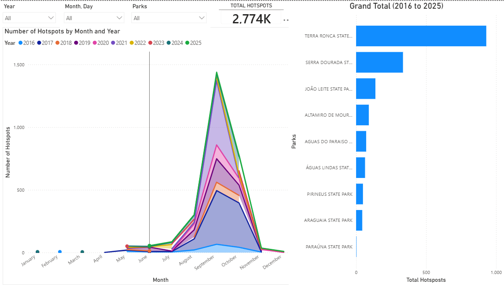
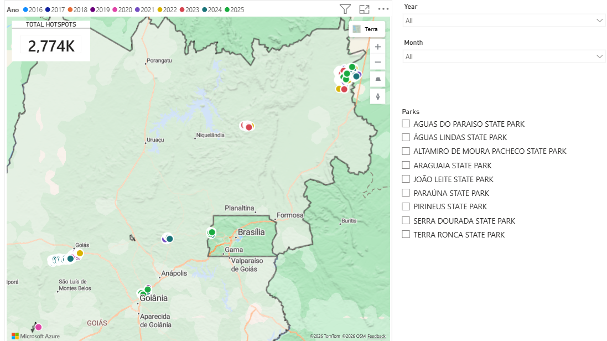
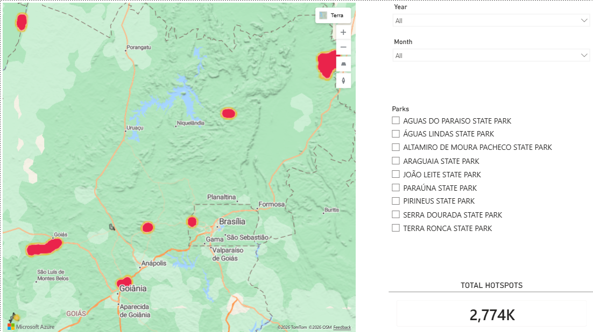

# Does a 3-Year Fire Rule Hold in the Cerrado? Heat-Hotspot Recurrence in Goiás State Parks, Brazil

Power BI, QGIS, Excel and Python analysis of 2,771 satellite heat hotspots recorded in 9 Goiás state parks between 2016 and 2025. The Goiás Military Fire Department (CBMGO) needed to answer an operational question: **after a fire, does Cerrado vegetation take about three years to recover enough fuel to burn again?** If so, recently burned areas could be left out of inspection rounds for three years. This project tests that assumption with ten years of satellite data, shows that the protection after a fire lasts about one year, not three, and proposes a safer way to prioritize prevention.

**[View the interactive Power BI dashboard](https://app.powerbi.com/view?r=eyJrIjoiNWRkNDQwN2QtOGRjOS00NjMwLTkzNTctMTBkMDZmZjY2YzhlIiwidCI6Ijk1NDYxM2ZhLWUzN2UtNDZkNi04NGYxLTJmYjNmMzY3MjExMyJ9)**

## Sample Delimitation

Of the 12 State Parks in Goiás, **9 recorded at least one heat hotspot** between 2016 and 2025 and form the sample:

- Águas do Paraíso State Park
- Águas Lindas State Park
- Altamiro de Moura Pacheco State Park
- Araguaia State Park
- João Leite State Park
- Paraúna State Park
- Pirineus State Park
- Serra Dourada State Park
- Terra Ronca State Park

Recurrence (the same location burning again) was observed in 8 of them. Paraúna recorded a single hotspot.

> **Methodological note:** The *Mata Atlântica*, *Serra de Caldas Novas* and *Serra de Jaraguá* state parks were excluded because no heat hotspot fell within their boundaries in the period, after the state-wide dataset was filtered by park limits. Satellite detection has known limits: small or short fires, or fires under cloud cover, may be missed. A park with no hotspot may therefore still have had undetected fires.

## Key Findings

- **The 3-year rule does not hold: fire protects an area for about one year, not three.** Burning in one year halves the odds of burning again the next year (odds ratio 0.54; p < 0.001). By the second year, the annual chance of a new fire has already doubled, from 6.4% to 12.7%, and remains at or above that level in years 3 and 4 (13.4% and 16.2%).
- **More than 1 in 5 burned areas burns again within 3 years** (at the ~1 km scale used). Kaplan-Meier survival analysis shows that 12.5% of burned areas burned again within 2 years and 22.7% within 3 years (95% CI: 19.6–25.8%). A 3-year skip would leave exactly these areas off the inspection list.
- **The most common interval was 2 years, consistent with the jump in risk in the second year.** Among the 499 recurrences, 2-year intervals were the most frequent (26.1%), followed closely by 4 and 3 years (23.0% and 22.4%).
- **Three years is a typical gap, not a safe minimum.** The median interval between fires at the same location is 2.98 years, statistically no different from 3 (Wilcoxon, p = 0.26), and the mean is 3.05 years. The average is close to the assumption, but the risk returns long before it: what matters for inspections is when protection ends, not the average gap.
- **Why protection ends so early: grasses are the leading explanation.** Cerrado studies report that the native grass layer recovers 70–80% of its biomass one year after fire and about 100% after two years, and invasive African grasses add even more fuel. This matches the jump in risk in the second year. This explanation comes from the literature and was not tested with project data.
- **Where and when fire happens is predictable.**
  - **Two parks:** Terra Ronca and Serra Dourada hold 71.2% of all hotspots.
  - **Three months:** 90.8% of hotspots fall between August and October, and September was the peak month in 7 of 10 years.
  - **Dry spells:** months with more days without rain have far more hotspots (Spearman ρ = 0.83 across monthly averages).
  - **Clusters:** fire is spatially clustered (Moran's I = 0.33; p = 0.001).
  - **Speed varies by park:** recurrence intervals tend to be shorter in Araguaia (median 2.1 years) than in Serra Dourada (4.0 years).

## Hypothesis Tree

**Hypothesis:** burned areas in Goiás state parks stay safe from new fires for about three years, while fuel recovers. All conditions must be true for the hypothesis to hold (AND logic); one false condition is enough to reject it.


**Verdict:** the hypothesis is rejected. Two necessary conditions fail, C1 with the recurrence data and C2 with the literature. C3 limits how precisely re-burns are measured, but not the direction of the conclusion.


## Dataset

**Heat hotspots** from INPE's [BDQueimadas](https://terrabrasilis.dpi.inpe.br/queimadas/bdqueimadas/) (NPP-375 / VIIRS satellite, Cerrado biome) and **state park boundaries** from SIGA, the Goiás State Environmental Geoinformation System.

| Variable | Description |
| --- | --- |
| Park | State park where the hotspot falls (after the QGIS overlay) |
| DateTime | Date and time of the satellite detection |
| Latitude, Longitude | Hotspot coordinates (decimal degrees) |
| DaysWithoutRain | Consecutive days without rain at detection (0–120) |
| Precipitation | Precipitation (mm) |
| FireRisk | INPE fire-risk index (0–1) |
| FRP | Fire Radiative Power (MW), the intensity of the fire |

A **commander survey** (Google Forms, 11 closed Likert questions) was answered by 16 CBMGO unit commanders (94.1% response rate).

## Data Preparation

- Overlaid the state-wide hotspots on the park boundaries in QGIS, keeping only hotspots inside the parks
- Removed 1 record outside the study period (2026). Rare but plausible values were kept: no data was removed for being extreme
- FRP was not captured for 1,048 hotspots, and 40 FRP values were physically impossible (import errors) and treated as missing (1,088 in total, 39%); FRP analyses use the 1,683 hotspots with a valid value
- Records with missing fire risk (27) were excluded only from the analyses that use that variable
- Grouped hotspots into a **0.01° grid** (cells of about 1.1 km, ~120 ha), the unit used to define "the same location"
- Treated hotspots in the same cell less than 180 days apart as **one fire event** (the same fire season)
- Calculated the **interval of recurrence** as the time, in years, between consecutive fire events in the same cell: **499 recurrences** across 723 burned cells (349 of them burned more than once)

## Analysis

1. **Descriptive analysis** of every variable (mean, median, quartiles, skewness, histograms).
2. **Normality tests** (Shapiro-Wilk and Kolmogorov-Smirnov with Lilliefors correction): no variable is normal (p < 0.001), so **non-parametric tests** were used.
3. **Tests chosen by the question:**

| Question | Test |
| --- | --- |
| Is the median interval different from 3 years? | Wilcoxon one-sample |
| Do more than half of recurrences happen before 3 years? | Binomial |
| What share of burned areas burns again in 1, 2 and 3 years? | Kaplan-Meier (areas that never burned again treated as censored) |
| Does burning one year lower the chance of burning the next? | Logistic regression (cluster-robust errors by cell) |
| Are weather variables associated with hotspots? | Spearman (Pearson shown for comparison) |
| Is frequent fire less intense? | Mann-Whitney U |
| Do intervals and intensity differ by park? | Kruskal-Wallis + Dunn (Holm correction) |
| Are hotspots evenly spread across months? | Chi-square goodness of fit |
| Are hotspots increasing or decreasing? | Mann-Kendall + Sen's slope |
| Does fire cluster in space? | Moran's I (999 permutations) |

## Results Summary

| What we found | Number | What it means for CBMGO |
| --- | --- | --- |
| Protection after a fire lasts about 1 year | Annual chance of fire: 6.4% in year 1 → 12.7% in year 2 | Burned areas need inspection again from the second year |
| Many burned areas burn again inside the 3-year window | 22.7% within 3 years | A 3-year skip would miss more than 1 in 5 re-burns |
| Three years is only the typical gap | Median 2.98 years; mode 2 years | The average cannot be used as a safe period |
| Fire concentrates in two parks | 71.2% in Terra Ronca and Serra Dourada | Most prevention effort belongs there |
| Fire concentrates in three months | 90.8% between August and October | Prevention must be ready before August |
| Drought goes with fire | Spearman ρ = 0.83 (monthly) | Days without rain can work as an alert signal |

## Recommendations

| Priority | Action | Why | When |
| --- | --- | --- | --- |
| **1** | **Do not adopt the 3-year skip.** Keep burned areas on the inspection list from the second year after a fire | The risk of a new fire doubles in year 2; 22.7% re-burn within 3 years | Before the next fire season |
| **2** | **Rank park sectors by risk** (fire history, month and days without rain) and send crews to the highest-ranked sectors first | Fire is predictable in space and time | Ranking ready by June |
| **3** | **Focus pre-season prevention on Terra Ronca and Serra Dourada:** firebreaks and patrols in June–July | 71% of hotspots fall in these two parks; 91% between August and October | June–July |
| **4** | **Use drought as an alert:** raise patrol frequency when days without rain increase | Drier months have far more hotspots | During the dry season |

## Next Steps

1. **Pilot the risk ranking for one fire season** and check where new hotspots fell: the share in top-priority sectors should be higher than under the 3-year rule.
2. **Define the inspection unit with CBMGO** (patrol sector or firebreak-bounded area) and rerun the analysis at that scale.
3. **Test the grass hypothesis** with MapBiomas land-cover and burned-area maps, comparing re-burn intervals in grassland, savanna and invaded areas.
4. **Refresh the dashboard every season** with new INPE data and normalize hotspots by park area.

## Power BI Dashboard

- **KPI card:** total heat hotspots
- **Hotspots by month and year:** seasonal curve for each year, 2016–2025
- **Ranking of parks** by total hotspots
- **Hotspot map** with each point colored by year
- **Heat map** of hotspot density across the state
- **Filters:** year, month and park

[](https://app.powerbi.com/view?r=eyJrIjoiNWRkNDQwN2QtOGRjOS00NjMwLTkzNTctMTBkMDZmZjY2YzhlIiwidCI6Ijk1NDYxM2ZhLWUzN2UtNDZkNi04NGYxLTJmYjNmMzY3MjExMyJ9)

| Hotspot map | Heat map |
| --- | --- |
|  |  |

**[Open the interactive dashboard](https://app.powerbi.com/view?r=eyJrIjoiNWRkNDQwN2QtOGRjOS00NjMwLTkzNTctMTBkMDZmZjY2YzhlIiwidCI6Ijk1NDYxM2ZhLWUzN2UtNDZkNi04NGYxLTJmYjNmMzY3MjExMyJ9)** (no login required)

---

## Appendix

### A1. Full statistical results

| Test | Result | p-value | Effect size | Interpretation |
| --- | --- | --- | --- | --- |
| Wilcoxon (median = 3 years) | Median 2.98 years | 0.262 | r = 0.05 | The median interval does not differ from 3 years |
| Binomial (< 3 years > 50%) | 257 of 499 = 51.5% | 0.265 | h = 0.03 | About half of recurrences happen before 3 years |
| Kaplan-Meier | 3.3% · 12.5% · 22.7% re-burned at 1, 2 and 3 years | — | 95% CI at 3 years: 19.6–25.8% | More than 1 in 5 burned areas burns again within 3 years |
| Logistic regression | Odds ratio 0.54 (95% CI 0.41–0.70) | < 0.001 | 6.4% vs 11.3% | Fire halves the next-year odds; by year 2 the risk doubles (OR ≈ 2.1) |
| Spearman: days without rain × hotspots (monthly, n = 12) | ρ = 0.83 (Pearson r = 0.42) | < 0.001 (Pearson 0.178) | Strong | Drier months have far more hotspots; the relationship is not linear |
| Spearman: days without rain × hotspots (year-month, n = 69) | ρ = 0.36 | 0.003 | Moderate | The association holds at a finer time scale |
| Spearman: fire risk × hotspots (monthly) | ρ = 0.85 | < 0.001 | Strong | INPE's fire-risk index tracks hotspot counts |
| Spearman: precipitation × hotspots (monthly) | ρ = −0.35 | 0.263 | Weak | No significant association |
| Mann-Whitney (FRP, < 3 vs ≥ 3 years) | 8.45 vs 9.10 MW | 0.026 | r = 0.10 | Frequent fire is only slightly less intense |
| Kruskal-Wallis (interval by park) | H(7) = 43.8 | < 0.001 | ε² = 0.075 | The distribution of intervals differs by park: shorter in Araguaia (median 2.1 years) than in Serra Dourada (4.0) and Pirineus (4.6) |
| Kruskal-Wallis (FRP by park) | H(7) = 173.4 | < 0.001 | ε² = 0.10 | Fire intensity tends to be higher in Altamiro, João Leite and Pirineus |
| Chi-square (months) | χ²(11) = 9,335 | < 0.001 | V = 0.55 | Strong seasonality |
| Mann-Kendall (hotspots per year) | Sen's slope −16 hotspots/year | 0.107 | τ = −0.42 | Downward signal, not significant |
| Mann-Kendall (fire events per year) | Sen's slope −9 events/year | 0.049 | τ = −0.51 | Fire events declined, at the 5% limit |
| Moran's I | I = 0.33 | 0.001 | — | Fire clusters in space |

### A2. Normality tests

| Variable | n | Mean | Median | Skewness | Normal? |
| --- | --- | --- | --- | --- | --- |
| Interval (years) | 499 | 3.05 | 2.98 | 0.80 | No |
| FRP (MW) | 1,683 | 13.91 | 8.10 | 5.40 | No |
| Days without rain | 2,771 | 26.60 | 6.00 | 1.13 | No |
| Precipitation (mm) | 2,771 | 0.36 | 0.00 | 8.50 | No |
| Fire risk | 2,744 | 0.94 | 1.00 | −3.53 | No |

### A3. Recurrence intervals

| Interval (whole years) | Recurrences | % | Cumulative % |
| --- | --- | --- | --- |
| 1 year | 78 | 15.6% | 15.6% |
| 2 years | 130 | 26.1% | 41.7% |
| 3 years | 112 | 22.4% | 64.1% |
| 4 years | 115 | 23.0% | 87.2% |
| 5 years | 23 | 4.6% | 91.8% |
| 6 years | 15 | 3.0% | 94.8% |
| 7 years | 25 | 5.0% | 99.8% |
| 8 years | 1 | 0.2% | 100% |
| **Total** | **499** | **100%** | |

**About the 7-year peak:** 18 of the 25 seven-year intervals come from the same area of Serra Dourada, burned by large fires in September 2017 and again in October 2024, with no hotspots in between. One large fire covers several grid cells, so it produces several recurrences. These cases were kept: they are real fires, not errors.

### A4. Annual chance of a new fire, by years since the last one

| Years since last fire | Chance of burning that year | Cell-years |
| --- | --- | --- |
| 1 | 6.4% | 1,193 |
| 2 | 12.7% | 1,033 |
| 3 | 13.4% | 856 |
| 4 | 16.2% | 698 |

### A5. Sensitivity to the size of the area

| Cell size | Burned areas | Re-burned within 3 years | Median interval | Chance of fire in year 1 → year 2 |
| --- | --- | --- | --- | --- |
| ~375 m (satellite pixel) | 2,167 | 5.8% | 3.9 years | 1.2% → 2.9% |
| **~1.1 km (used)** | **723** | **22.7%** | **3.0 years** | **6.4% → 12.7%** |
| ~2.2 km | 269 | 40.6% | 2.1 years | 17.3% → 21.2% |
| ~5 km | 84 | 59.3% | 1.3 years | 38.8% → 33.6% |

The ~1.1 km grid was kept because it is larger than the satellite's position error and close to the scale of an inspection area. The jump in risk from year 1 to year 2 holds at every scale up to ~2 km.

### A6. The grass hypothesis

- **The native grass layer recovers quickly.** In Cerrado *campo sujo*, about 70–80% of ground-layer biomass returns one year after fire, and about 100% after two years (Andrade, 1998; Neto et al., 1998, cited in Gorgone-Barbosa et al., 2016; Onigemo, Miranda & Haridasan, 2003).
- **Invasive African grasses add fuel.** Species such as *Melinis minutiflora* (capim-gordura) and *Urochloa* spp. (braquiária) accumulate more biomass than native species, and flames in invaded plots were up to twice as tall (Gorgone-Barbosa et al., 2016; Pivello et al., 2021).

### A7. Commander survey

| Statement | Result |
| --- | --- |
| Wildfires demand a lot of attention from my unit | 100% agree |
| I have difficulty identifying risk areas | 43.8% |
| Main difficulties | Lack of personnel 93% · Lack of organized information 50% · Lack of adequate tools 31.3% |
| A dashboard showing high-risk areas would support prevention planning | 93.8% agree |
| I am willing to use the proposed tool | 100% agree |

### A8. Limitations

- Heat hotspots are an indirect indicator: one fire can generate many hotspots, and small fires may go undetected.
- Neighboring cells hit by the same large fire are not independent; p-values may be slightly optimistic.
- Results depend on the size of the area analyzed (A5); the ideal unit would be the inspection sector used by CBMGO.
- No local data on vegetation, grass cover or biomass: the grass explanation relies on the literature.
- Fire intensity (FRP) is missing for 39% of hotspots.
- No data on ignition causes; hotspots not normalized by park area; correlations show association, not causation.

## Tools

- **QGIS:** spatial overlay of hotspots and park boundaries
- **Excel:** data cleaning, frequency tables and first descriptive analysis
- **Python:** event grouping, normality tests and statistical tests (scipy, pandas)
- **Power BI:** interactive dashboard
- **Google Forms:** commander survey

## Project Structure

```
goias-wildfire-hotspots-bi/
│
├── README.md
│
├── data/
│   ├── README.md                 (data dictionary)
│   └── heat_hotspots_2016_2025.csv
│
├── python/
│   └── recurrence_analysis.py    (statistical analysis)
│
├── powerbi/
│   └── wildfire_hotspots_dashboard.pbix
│
└── assets/
    ├── wildfire_hypothesis_tree.png
    └── dashboard_preview.png, dashboard_map.png, dashboard_heatmap.png
```

## References

- Gorgone-Barbosa, E.; Pivello, V. R.; Rissi, M. N.; Zupo, T.; Fidelis, A. (2016). A importância da consideração de espécies invasoras no manejo integrado do fogo. *Biodiversidade Brasileira*, 6(2), 27–40.
- Onigemo, A. E.; Miranda, H. S.; Haridasan, M. (2003). Efeitos de queimadas bienais e quadrienais sucessivas sobre a biomassa do estrato rasteiro de campo sujo de cerrado. *Anais do VI Congresso de Ecologia do Brasil*, 360–362.
- Pivello, V. R. et al. (2021). Understanding Brazil's catastrophic fires: causes, consequences and policy needed to prevent future tragedies. *Perspectives in Ecology and Conservation*, 19(3), 233–255.
- MapBiomas (2025). *RAF 2024: Annual Fire Report, Collection 4 (1985–2024).*
